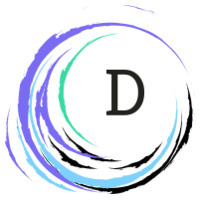

<div align="center">



# DocNexus

### 📚 Turn scattered study PDFs into one perfect knowledge base

Upload several PDFs on the same topic. DocNexus merges them into a single, clean set of notes — duplicates removed, conflicts flagged, diagrams and tables kept — then adds flashcards, a quiz, a revision sheet, an AI tutor, and previous-year question-paper analysis.


</div>

---

## ✨ Features

| | Feature | What it does |
|---|---|---|
| 🧩 | **Knowledge fusion** | Combines multiple PDFs into one set of unified notes, merging the same topic from different sources and removing repeated content. |
| ⚠️ | **Conflict detection** | When sources disagree on a fact, both versions are surfaced in a *Conflicts* tab instead of silently picking one. |
| 🖼️ | **Diagrams & tables preserved** | Figures, tables and grids are detected, cropped from the PDFs and placed under the right topic. Duplicate pictures across sources are removed. |
| 🗂️ | **Source-faithful structure** | Notes keep headings, paragraphs, lists and nested numbering like the originals — no empty headings, no generic labels. |
| 🃏 | **Flashcards, quiz & revision sheet** | Generated together with the notes, so there is nothing extra to wait for. |
| 💬 | **Ask DocNexus (RAG chat)** | Ask questions and get answers grounded in your own notes, with citations from the retrieved sections. |
| 📝 | **Question-paper analysis** *(optional)* | Add previous-year papers from the Unified Notes tab to see which topics were asked, how often, and in which years. The chat can then answer "what was asked last year?". |
| 📄 | **PDF export** | Download the unified notes as a formatted PDF. |
| 🔐 | **Accounts & saved projects** | Sign up with email and password. Every project is stored on your account and can be reopened, exported or deleted from **My projects**. |

## 🏗️ How it works

```
 PDFs ──► Extract text, figures & tables ──► Split into topics ──► Embed (Cohere)
                                                                      │
        Notes ◄── Merge & dedupe (LLM) ◄── Group similar topics ◄─────┘
          │
          ├──► Flashcards · Quiz · Revision sheet
          ├──► Vector search ──► Chat (RAG)
          └──► Question papers ──► Topic matching ──► "Most asked" stats
```

1. **Extraction** – `pdfjs-dist` reads text with layout; tables, figures and grids are located and cropped as images.
2. **Chunking & embeddings** – content is split into topics and embedded with Cohere `embed-english-v3.0`.
3. **Fusion** – similar topics from different PDFs are grouped and merged by the LLM; contradictions become conflicts.
4. **Retrieval** – MongoDB Atlas Vector Search, with an in-memory similarity fallback so chat still works if the index is missing or building.
5. **Exam analysis** – each question is matched to the closest note topic by embedding similarity.

## 🧰 Tech stack

- **Backend:** Node.js, Express, Mongoose
- **Database:** MongoDB Atlas (+ Atlas Vector Search)
- **AI:** Cohere (embeddings, generation, chat) through LangChain
- **PDF:** pdfjs-dist, pdf-parse, PDFKit, @napi-rs/canvas
- **Frontend:** vanilla JavaScript, HTML, Tailwind CSS (CDN)
- **Auth:** Node `crypto` only — scrypt password hashing and HMAC-signed tokens

## 📁 Project structure

```
DocNexus/
├── backend/
│   ├── server.js             # Express app entry point
│   ├── config/               # Database setup
│   ├── models/               # Mongoose models (User, Project, notes, chunks…)
│   ├── routes/               # authRoutes, projectRoutes
│   ├── controllers/          # Request handlers
│   ├── services/             # Pipeline, fusion engine, RAG, PDF, exam analysis, auth
│   ├── scripts/              # One-off scripts (e.g. vector index creation)
│   └── uploads/              # Uploaded PDFs (git-ignored)
└── frontend/
    ├── index.html            # Upload page
    ├── results.html          # Notes, conflicts, study material, chat
    ├── projects.html         # My projects
    ├── login.html            # Sign in / create account
    ├── assets/               # Logo
    └── js/                   # app.js, auth.js, results/*
```

## 🚀 Getting started

### Prerequisites

- 🟢 **Node.js 18+**
- 🍃 A **MongoDB Atlas** cluster (the free tier works)
- 🔑 A **Cohere API key** — [dashboard.cohere.com](https://dashboard.cohere.com)

### 1. Install

```bash
git clone <your-repo-url>
cd DocNexus
npm install            # root: live-server + concurrently
cd backend && npm install
```

### 2. Configure

Create `backend/.env`:

```env
PORT=5000
NODE_ENV=development

# MongoDB Atlas connection string
MONGODB_URI=mongodb+srv://<user>:<password>@<cluster>/<db>

# Cohere
COHERE_API_KEY=your-cohere-key

# Atlas Vector Search index names (optional – these are the defaults)
VECTOR_INDEX_NAME=vector_index
QP_VECTOR_INDEX_NAME=qp_vector_index

# Max upload size per PDF
MAX_FILE_SIZE_MB=20
```

**Optional tuning**

| Variable | Default | Purpose |
|---|---|---|
| `FUSION_USE_AI` | on | Set to `0` to skip the LLM merge and use local structuring only. |
| `EXAM_MATCH_THRESHOLD` | `0.42` | Similarity needed to match an exam question to a topic. |
| `NOTE_VECTOR_INDEX_NAME` | `note_vector_index` | Vector index for unified notes. |

### 3. (Recommended) Create the vector search indexes

Chat works without them (it falls back to in-memory search), but Atlas Vector Search is faster on large projects. Create them with `node backend/scripts/createVectorIndex.js`.

### 4. Run

From the project root:

```bash
npm run dev       # backend (nodemon) + frontend (live-server)
```

Or run them separately:

```bash
npm run backend   # API on http://localhost:5000
npm run frontend  # static site served by live-server
```

Open the frontend, **create an account**, upload two or more PDFs, and click **Start Fusion**.

## 🧭 Using DocNexus

1. 🔐 **Create an account / sign in.**
2. 📤 **Upload** two or more PDFs on the same topic (optionally add a topic label) and start the fusion.
3. 📖 Read the **Unified Notes**, check the **Conflicts** tab, and export the PDF if you like.
4. 🃏 Open **Flashcards**, **Quiz** and the **Revision sheet** — they are ready with the notes.
5. 📝 *(Optional)* In the Unified Notes tab, add **previous-year question papers** to see most-asked topics.
6. 💬 Use **Ask DocNexus** to query your notes.
7. 📂 Come back any time from **My projects**.

## 🔌 API overview

All `/api/projects/*` routes require `Authorization: Bearer <token>` and only return the signed-in user's projects.

| Method | Endpoint | Description |
|---|---|---|
| `POST` | `/api/auth/register` | Create an account |
| `POST` | `/api/auth/login` | Sign in, returns a token |
| `GET` | `/api/auth/me` | Current user |
| `GET` | `/api/projects` | List my projects |
| `POST` | `/api/projects/upload` | Upload PDFs and start a fusion |
| `GET` | `/api/projects/:id/status` | Processing progress |
| `GET` | `/api/projects/:id/results` | Notes, conflicts, stats |
| `GET` | `/api/projects/:id/export/:kind` | Download a PDF |
| `GET` | `/api/projects/:id/study-material-status` | Flashcards / quiz / revision readiness |
| `POST` | `/api/projects/:id/chat` | Ask a question about the notes |
| `POST` | `/api/projects/:id/question-papers` | Add previous-year question papers later |
| `GET` | `/api/projects/:id/qp-status` | Question-paper processing status |
| `GET` | `/api/projects/:id/exam-analysis` | Most-asked topics |
| `POST` | `/api/projects/:id/exam-question` | Ask about an exam question |
| `DELETE` | `/api/projects/:id` | Delete a project |

## 🔒 Security notes

- Passwords are hashed with scrypt; tokens are HMAC-signed. No plaintext passwords are stored.
- Keep `.env` out of git (already in `.gitignore`). The login-signing key is generated automatically on first start and saved in `backend/.jwt-secret`, which is also git-ignored.
- Uploaded PDFs are stored in `backend/uploads/` and are git-ignored.
- Rotate any credentials that were ever committed or backed up (for example, old `.env` copies).

## 🗺️ Roadmap

- 🔑 Sign in with Google
- 🔁 Password reset by email
- ➕ Add documents to an existing project
- 🌐 Production deployment guide

---

<div align="center">Made with ❤️ for students who are tired of juggling ten PDFs.</div>
